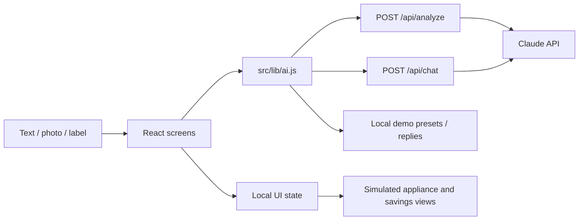

# Miele TextilExpert
### Textile care, explained through an interactive AI prototype

A **React application prototype** from the TU Berlin × Miele Innovationswerkstatt. It explores how label/photo analysis and a conversational assistant can make textile care easier to understand.

**Stack:** React 18 · Vite · JavaScript · Vercel Functions · Claude Vision · PWA manifest · Capacitor configuration

**Status:** workshop prototype. Appliance state, household flows and maintenance views are simulated. The repository does not implement a live connection to a washing machine or a trained predictive-maintenance system.

## What to try

| Flow | What it demonstrates |
| --- | --- |
| TextilExpert | Label/photo or text input → care analysis → program recommendation |
| Assistant | Conversational care guidance, with optional server-side AI |
| Live wash | Simulated program phases and time-lapse interaction |
| Digital twin | A maintenance and device-state interface concept |
| Household and Eco | Household-access and savings interface concepts |

## Architecture



The browser calls server-side functions, so the provider key is not embedded in frontend requests. Without configured AI, the application can use local demo responses. A demo result should be understood as a preset, not as evidence that an uploaded image was analyzed by a live model.

## Implementation and contribution

The [prototype implementation](https://github.com/gorillathecode/miele-textilexpert/commit/8f873655da508d2ff695043c527db934f064e969) is published under my account and credits AI coding assistance. It combines the interface, demo state and provider integration in this repository. Workshop context and the Miele brand are not a claim that this is an official released Miele application.

Start here:
- [App composition and local state](src/App.jsx)
- [Textile analysis screen](src/screens/Textil.jsx)
- [AI calls and demo fallback](src/lib/ai.js)
- [Server-side photo/text analysis](api/analyze.js)
- [Server-side chat](api/chat.js)

## Run the demo

```bash
npm ci
npm run dev
```

Use the local Vite URL. Demo presets allow the interaction to be explored without a provider key.

A short walkthrough:
1. Complete onboarding.
2. Open **TextilKI** and explore a demo textile.
3. Inspect the proposed program and care guidance.
4. Use **Programm an Maschine senden** to enter the **simulated** wash flow.
5. Explore **Zeitraffer**, the digital-twin view and the Eco tab.

Onboarding uses browser storage; clear this application's local storage to repeat it.

## Optional live AI

Deploy the Vite application and `api/` functions to Vercel. Configure `ANTHROPIC_API_KEY` as a server-side environment variable and, if needed, `ANTHROPIC_MODEL` for a supported model in your account.

Vite's local development server does not itself host the Vercel functions. A successful local demo does not validate the live provider path.

## Web and mobile scope

The repository contains a web manifest and Capacitor configuration. Explore the web prototype first. Native targets need their platform tooling and API routing configured; native release readiness is not claimed.

Existing helper commands:

```bash
npm run build
npm run cap:add:ios
npm run cap:add:android
npm run cap:sync
```

## Limits

Recommendations are a prototype interaction, not verified appliance-control instructions. Maintenance probabilities, device readings and savings displayed by the demo are illustrative. There is no production access-control backend for the household concept.
